# User guide

Command line, configuration files, outputs of a run, distributions and the Python interface of `PA_auctions`. Installation, tests and the reproduction of the paper's experiment are in the [README](../README.md).

**Contents**

1. [Command line: `run.py`](#1-command-line-runpy)
2. [Configuration files](#2-configuration-files): [top level](#21-top-level) · [`[[distributions]]`](#22-distributions) ([family options](#family-options)) · [`[markets]`](#23-markets) · [`[design]`](#24-design) · [`[[optimizers]]`](#25-optimizers) · [`[[thresholds]]`](#26-thresholds) · [`[evaluation]`](#27-evaluation) · [`[checks]`](#28-checks) · [`[seeds]`](#29-seeds) · [`[output]`](#210-output)
3. [Outputs of a run](#3-outputs-of-a-run)
4. [Distributions](#4-distributions)
5. [Python interface](#5-python-interface)

## 1. Command line: `run.py`

```
python run.py CONFIG.toml [--dry-run] [--yes] [--workers N] [--no-report]
python run.py --report RUN_FOLDER [--paper [NAMES]] [--workers N]
python run.py --options
```

| Option | Meaning |
|---|---|
| `CONFIG.toml` | configuration of the run ([§2](#2-configuration-files)); starts a new run folder |
| `--dry-run` | print the plan (combinations, skipped combinations) and the time estimate, then stop |
| `--yes` | do not ask before running (batch jobs) |
| `--workers N` | number of worker processes; overrides `output.workers`; default: number of cores − 2 |
| `--no-report` | compute only, no figures; overrides `output.report` |
| `--report RUN_FOLDER` | redraw every figure and README of an existing run from its saved data; no recomputation |
| `--paper [NAMES]` | with `--report`: export figures for a paper ([§3.6](#36-figures-for-a-paper)); `NAMES` is a comma-separated subset, default all |
| `--options` | list the distributions, forms, objectives, optimizer methods, threshold sources and every default |

**Examples:**

```bash
python run.py configs/paper_run.toml --dry-run
python run.py configs/paper_run.toml --yes --workers 12
python run.py --report runs/RUN
python run.py --report runs/RUN --paper outcomes,ironing
```

## 2. Configuration files

A run is described by one TOML file. Every list is a set of values. The run computes every combination of:

- the distributions and the ζ values of each;
- the lists in `[markets]` and `[design]`;
- the `[[optimizers]]` tables and the threshold forms of each (optimize runs), and the `[[thresholds]]` tables (evaluate runs; optional in optimize runs).

Unknown keys are an error. Example files in [configs/](../configs/):

| File | Purpose |
|---|---|
| [paper_run.toml](../configs/paper_run.toml) | the experiment of the paper: independent, harmful_middle, heavy_tail, harm_rises; 20 markets (k/n from 1/32 to 1); optimized τ for both objectives, best cutoff and best clipped affine τ by [grid search](#grid-search), given τ⁰, τ^EA and relaxation τ; 716 combinations |
| [smoke_test.toml](../configs/smoke_test.toml) | smoke test: 3 combinations (three optimizers) through every stage, about 15 s; results not meaningful |
| [evaluate_example.toml](../configs/evaluate_example.toml) | evaluate run: the zero-welfare threshold τ⁰, the ex ante welfare cutoff τ^EA, and a given affine τ |

### 2.1 Top level

| Key | Values | Meaning |
|---|---|---|
| `kind` | `"optimize"`, `"evaluate"` | optimize: search for τ in each combination, then evaluate it (plus any given τ in `[[thresholds]]`); evaluate: evaluate given τ only |
| `name` | text | part of the run folder name `<date>_<time>_<kind>_<name>` |
| `description` | text | shown in the run's README |

### 2.2 `[[distributions]]`

One table per distribution; at least one.

| Key | Default | Meaning |
|---|---|---|
| `source` | required | a synthetic family (`a`–`f`, `h`, `example_n`, `independent`, `harm_rises`, `harmful_middle`, `heavy_tail`; [definitions](#family-options)), or a path to a CSV file with columns `e_score`, `v_score` |
| `label` | source name | folder name of the distribution |
| `externality_scales` | `[1.0]` | externality scales ζ (e = ζ · e_score); one sub-folder `z<ζ>` each |
| `num_externality_nodes` | 151 (synthetic), 241 (empirical) | externality grid of the piecewise-uniform distribution |
| `num_valuation_cells` | 150 (synthetic), 400 (empirical) | valuation cells per externality node |
| `options` | `{}` | synthetic only: family parameters, e.g. `options = {correlation = -0.4}` for `harm_rises`; every family's options: [table below](#family-options) |
| `valuation_scale` | 1.0 | empirical: valuation of one action (v = valuation_scale · v_score) |
| `truncation_quantile` | 0.995 | empirical: training rows with v above this quantile of all rows are dropped; the quantile is the valuation bound v̄ |
| `evaluation_truncation_quantile` | `truncation_quantile` | empirical: the same for the test rows (1.0 keeps every row) |
| `train_fraction` | 0.5 | empirical: share of rows in the training half |
| `smoothing` | `"kernel"` | empirical: training half kernel-smoothed (`"kernel"`) or used as atoms (`"none"`) |
| `bandwidth_scale` | 1.0 | empirical: multiplier of the kernel bandwidth |
| `evaluation` | `"atomic"` | empirical: test half as atoms (`"atomic"`) or smoothed like the training half (`"smoothed"`) |

<a id="family-options"></a>**Family options** (`options = {...}`; unknown names are an error; `python run.py --options` lists them). Every family is truncated to v ≥ 0 and gridded with `num_externality_nodes` × `num_valuation_cells`. Previews: [§4](#4-distributions).

| Family | Distribution | Options (default) |
|---|---|---|
| `a`–`f`, `h` | equal-weight mixtures of bivariate normals at (e, v) = `a` (0, 1); `b` (−1, 1), (0, 1); `c` (−1, 1), (0, 2); `d` (−1, 2), (0, 1); `e` (0, 2), (0, 1); `f` the four of `b`–`e`; `h` (0, 2); variances 0.1 (`a`, `h`) or 0.05, independent coordinates; cut at ±5 sd | none |
| `example_n` | v ~ U[0, 1]; e ∈ {−c, 0} with probability ½ each, independent of v | `harm` c (0.6) |
| `independent` | v ~ U[0, 1] independent of e ~ N(μ, σ²) | `externality_mean` μ (−0.3), `externality_sd` σ (0.5) |
| `harm_rises` | (e, v) bivariate normal | `means` [e, v] ([−0.3, 1.0]), `standard_deviations` [e, v] ([0.5, 0.4]), `correlation` (−0.6) |
| `harmful_middle` | v ~ N(μ_v, σ_v²); given v, e ~ N(m(v), s(v)²) with m(v) = μ_e + b (v − μ_v) − A x e^{(1 − x²)/2}, s(v) = σ_e + S e^{−x²/2}, x = (v − c)/W. The ridge m(v) falls with slope b, is A above that line at v = c − W and A below it at v = c + W; S widens the ridge there ([previews](#harmful-middle-options)) | `valuation_mean` μ_v (1.0), `valuation_sd` σ_v (0.45), `externality_mean` μ_e (−0.3), `slope` b (−0.9), `externality_sd` σ_e (0.4), `wiggle_amplitude` A (0.5), `wiggle_width` W (0.26), `wiggle_center` c (1.0), `wiggle_spread` S (0.38) |
| `heavy_tail` | log v ~ N(0, s²), truncated at its q quantile; given v, e ~ N(−a √v, σ²) | `log_valuation_sd` s (1.0), `truncation_quantile` q (0.995), `harm_slope` a (0.5), `externality_sd` σ (0.4) |

### 2.3 `[markets]`

| Key | Default | Meaning |
|---|---|---|
| `num_bidders` | `[8]` | numbers of bidders n |
| `num_goods` | `[1]` | numbers of identical goods k |
| `pairs` | `[]` | instead of the two keys above: the markets as a list of [n, k] pairs, e.g. `[[4, 1], [8, 2]]` (skips the cells of the n × k grid you don't want, such as k ≥ n) |

Without `pairs`, the run uses every n × k.

### 2.4 `[design]`

Optimize runs only.

| Key | Default | Meaning |
|---|---|---|
| `objectives` | `["vcg_pa"]` | auction whose exact expected welfare τ maximizes: `vcg_pa`, `ivcg_pa` |

The forms of τ are set per optimizer (`threshold_forms` in [`[[optimizers]]`](#25-optimizers)). A `threshold_forms` key in `[design]` is an error.

### 2.5 `[[optimizers]]`

Optimize runs only; default: one threshold-response optimizer. Each table is one optimizer with its own forms of τ; the run computes every objective × optimizer × form of that optimizer (objectives: `[design]`, or the table's own `objectives`). Keys: [every method](#every-method), [genetic search](#genetic-search), [threshold-response ascent](#threshold-response-ascent), [symmetric relaxation](#symmetric-relaxation), [grid search](#grid-search).

<a id="every-method"></a>**Every method:**

| Key | Default | Meaning |
|---|---|---|
| `method` | required | `genetic` (genetic stage + Nelder–Mead), `threshold_response` (threshold-response ascent + gradient polish), `genetic+threshold_response` (ascent also started from a genetic result), `relaxation` (ascent from the symmetric relaxation only; below), `grid` (every point of a grid + Nelder–Mead; `cutoff` and `poly1` only; below) |
| `threshold_forms` | `["knots6"]`; `["nodes"]` for `relaxation`; `["poly1"]` for `grid` | forms of τ this optimizer searches (table below); a form the method cannot search is an error |
| `objectives` | the `[design]` objectives | objectives of this optimizer only (e.g. `["vcg_pa"]`) |
| `label` | `ga`, `tr`, `ga-tr`, `relax`, `grid` | optimizer label in folder names; several tables may share a label if they share the method and give different folders (e.g. one `grid` table per set of objectives) |
| `time_limit_minutes` | 60 | search time per combination (all stages and starts); past it, each stage stops after its current iteration, later starts are skipped, the best τ so far is kept, and check `search_stop` fails; 0 = no limit |

| Form | τ(e) | Methods |
|---|---|---|
| `poly<d>` | polynomial of degree d (`poly1`: clipped affine τ(e) = min{v̄, max{0, a − θe}}) | genetic; `poly1` also grid |
| `knots<K>` | continuous piecewise linear with K knots, plus an exclusion cutoff | all |
| `bins<K>` | constant on K bins | all |
| `cutoff` | common welfare cutoff c: τ(e) = max(0, c − e), excluded if c − e > v̄ | genetic, grid |
| `nodes` | free value at every externality node | threshold response, genetic+threshold response, relaxation |

Example: genetic search on a polynomial and a piecewise-linear τ, threshold-response ascent per node:

```toml
[[optimizers]]
method = "genetic"
threshold_forms = ["poly2", "knots6"]

[[optimizers]]
method = "threshold_response"
threshold_forms = ["nodes"]
```

<a id="genetic-search"></a>**Genetic search** (`genetic`, and the genetic stage of `genetic+threshold_response`):

| Key | Default | Meaning |
|---|---|---|
| `num_generations` | 500 | maximum generations |
| `population_size` | 50 | population size |
| `num_parents_mating` | 15 | parents per generation |
| `mutation_probability` | 0.25 | mutation probability per gene |
| `range_multiplier` | 3.0 | width of the search ranges of polynomial coefficients |
| `stall_generations` | 60 | stop once the best welfare has risen by at most `stall_tolerance` over this many generations |
| `stall_tolerance` | 1e-4 | the stall rule's gain, in units of the first-best gain FB − W_VCG on the training distribution |
| `num_restarts` | 4 | independent restarts (seeds `search`, `search + 1`, …), run in parallel |
| `local_refinement` | `"nelder_mead"` | `"nelder_mead"` or `"none"` |
| `num_local_starts` | 5 | Nelder–Mead starts |
| `local_max_evaluations` | 2000 | evaluations per Nelder–Mead start |

<a id="threshold-response-ascent"></a>**Threshold-response ascent** (`threshold_response`, `genetic+threshold_response`):

| Key | Default | Meaning |
|---|---|---|
| `starts` | `["zero", "zero_welfare", "short_genetic", "relaxation"]` | `zero`: τ ≡ 0; `zero_welfare`: the zero-welfare threshold τ⁰(e) = max(0, −e); `short_genetic`: a short genetic search in the same form; `relaxation`: the thresholds of the best symmetric participation rule for VCG-PA (`symmetric_relaxation.py`; skipped for atomic distributions) |
| `num_random_starts` | 3 | random starts in addition (τ piecewise linear through 6 externalities, values uniform on [0, 95% quantile of v]); all starts run in parallel |
| `max_iterations` | 100 | iterations per start |
| `relative_tolerance` | 1e-10 | stop when relative welfare gains fall below this |
| `polish_rounds` | 3 | gradient polishes (L-BFGS-B, at most 500 welfare evaluations each) |
| `short_genetic_generations` | 40 | generations of the `short_genetic` start |
| `genetic_form` | same form, or `knots6` for `nodes` | `genetic+threshold_response` only: form of the genetic stage |
| `warm_start_across_zeta` | false | also start from the optimum at the previous ζ, rescaled: τ(e) = τ_prev(e ζ_prev / ζ); the ζ values of a distribution then run in sequence |

<a id="symmetric-relaxation"></a>**Symmetric relaxation** (`relaxation`). A linear program (`symmetric_relaxation.py`, about 5 s per distribution, n, k) finds the best symmetric participation rule for VCG-PA: each type participates with some probability, the same for all bidders. Its value J bounds the VCG-PA welfare of every common τ from above (midpoint estimate, error of order (interval width)²). The method reads τ off it (each node's threshold is the first valuation at which at least half of the node participates; 0 if that is the node's lowest valuation), projects it on the form, and runs threshold-response ascent from that single start with the [threshold-response keys](#threshold-response-ascent) (`starts` and `num_random_starts` are ignored).

- **Record:** `results.json` → `search.relaxation`: `value` (J), `threshold_rule` (true: the best symmetric rule is a threshold rule, and the τ read off it is a best common τ for VCG-PA up to the discretization), `largest_drop`, `seconds`.
- **As a start:** the same τ is a default `starts` entry of `threshold_response`, where the best start is kept; the separate method shows what the relaxation gives alone.
- **Scope:** with the objective `ivcg_pa` it is a start only. Needs k < n and a piecewise-uniform training distribution; other combinations are skipped and listed in the plan.

<a id="grid-search"></a>**Grid search** (`grid`; `grid_search.py`). Exhaustive search of the one- and two-parameter forms, then Nelder–Mead. `cutoff`: `grid_points` welfare cutoffs w, evenly spaced on the genetic search range. `poly1`: `grid_points` × `grid_points` lines in the box of the type plane, by angle θ ∈ (0, π) and offset between the box's lowest and highest corner, so steep and flat lines are equally dense (θ → 0: vertical boundary, τ decreasing; offset 0: all participate; offset 1: all excluded). Nelder–Mead then starts from the best grid points that are strict local maxima of the grid, more than three grid spacings apart. Every evaluation is exact, so the result is at least the best grid value; about 1 ms per VCG-PA evaluation, so 121 × 121 lines take 15 s on one worker (grid points run in parallel).

| Key | Default | Meaning |
|---|---|---|
| `grid_points` | 121 | grid points per parameter |
| `grid_local_starts` | 5 | Nelder–Mead starts |
| `grid_local_max_evaluations` | 500 | evaluations per Nelder–Mead start |

- **Record:** `results.json` → `search.starts`: the `grid` entry (best grid welfare, `local_maxima` = number of strict grid local maxima, `polish_gain` and `second_local_optimum_gap` in units of the first-best gain), then one `nelder_mead` entry per start.

### 2.6 `[[thresholds]]`

Given τ, evaluated like an optimized τ in every market: required in evaluate runs (at least one), optional in optimize runs, where they serve as benchmarks next to the optimized τ (same figures, own rows in summary.csv, own class `tau-<label>` in gap-decomposition.csv, compared in `tau-by-threshold` figures). Each table has a `label` (folder name `tau-<label>`) and exactly one source:

| Key | Example | τ(e) |
|---|---|---|
| `polynomial` | `[0.0, -1.0]` | Σ_m a_m e^m (coefficients from degree 0) |
| `constant` | `0.3` | 0.3 |
| `cutoff` | `0.0` or `"ex_ante"` | max(0, c − e) for the common welfare cutoff c; `0.0` gives the zero-welfare threshold τ⁰; `"ex_ante"` gives the ex ante welfare cutoff w^EA with Pr[v + e > w^EA] = min{k/n, Pr[v + e > 0]} (paper, Corollary 6.5(3)), computed on the training distribution for each n, k |
| `relaxation` | `true` | the τ read off the symmetric relaxation for this n, k ([symmetric relaxation](#symmetric-relaxation)), on the `nodes` form: the same τ as the ascent's `relaxation` start; skipped where k ≥ n or the training data are atomic |
| `tabulated` | `{externalities = [-1, 0], values = [1, 0]}` | piecewise linear through the points, constant outside |
| `tau_file` | `"runs/<run>/<path>/tau.json"` | a τ saved by an earlier run |
| `from_run` | `"runs/<run>"` | every τ of an earlier run with the same distribution label, ζ, n and k (without `label`, the original design label is used) |

A τ value at or above v̄ excludes the externality (τ = v̄⁺ in the paper).

### 2.7 `[evaluation]`

| Key | Default | Meaning |
|---|---|---|
| `num_simulated_auctions` | 2000 | simulated auctions for the per-auction figures (the same auctions for every design of a market) |
| `num_bootstrap` | 200 | empirical: bootstrap resamples of the test rows |
| `confidence_level` | 0.95 | level of the bootstrap percentile intervals |
| `bootstrap_all_outcomes` | true | bootstrap every metric (revenue, penalties, welfare parts), not only welfare |
| `continuous` | true | evaluate on continuous versions of the gridded distributions ([§4](#continuous-evaluation)); the search stays on the grid. `false`: evaluate on the grid (runs made before this option) |

### 2.8 `[checks]`

| Key | Default | Meaning |
|---|---|---|
| `grid_refinement` | false | synthetic: recompute on a finer grid with τ fixed (continuous versions of both grids when `continuous`) |
| `refinement_factor` | 2 | refinement of both grids |
| `grid_relative_tolerance` | 0.01 | pass if every gain over VCG changes by less than this share |
| `bandwidth_sensitivity` | `[]` | empirical, optimize runs: redesign τ with these bandwidth multipliers, e.g. `[0.5, 2.0]` |
| `first_order_tolerance` | 1e-4 | `nodes` form: pass if the largest first-order violation / v̄ (\|M(e, τ(e))\| at interior thresholds; [check `first_order`](#34-checks)) is below this |
| `monte_carlo_z` | 4.0 | pass if every simulated mean is within this many standard errors of the exact value |
| `symmetric_relaxation` | true | piecewise-uniform training data: solve the best symmetric participation rule for VCG-PA (about 5 s per distribution, n, k; cached; shared with the `relaxation` method) and report the share of its gain that τ attains on the training grid |

### 2.9 `[seeds]`

| Key | Default | Used by |
|---|---|---|
| `split` | 0 | train/test split of empirical rows |
| `search` | 0 | genetic search and `short_genetic` starts |
| `simulation` | 1234 | simulated auctions |
| `bootstrap` | 0 | bootstrap resamples |

### 2.10 `[output]`

| Key | Default | Meaning |
|---|---|---|
| `base` | `"runs"` | folder of the run folders (relative to the code folder) |
| `workers` | 0 | parallel processes; 0 = number of cores − 2; `--workers` overrides. One process per combination; workers beyond the number of combinations go to each combination's parallel stages (search starts and restarts, Nelder–Mead starts, bootstrap) |
| `search_history_curves` | 400 | tried thresholds kept for `search/tried-taus.pdf` |
| `report` | true | draw figures after computing; `--no-report` overrides |
| `previews` | `"html"` | README previews: `"html"`, `` tags at a fixed display width (VS Code's classic Markdown preview, Cmd+Shift+V, and GitHub; VS Code's new markdown editor does not show them); `"markdown"`, markdown images shown at their pixel size (every Markdown viewer; set `preview_dpi` to about 60) |
| `preview_dpi` | 120 | pixels per inch of the WebP previews `thumbs/<name>.webp` (one per figure); at 120 and the default widths, about two image pixels per screen pixel on high-density screens |
| `preview_width` | 440 | `"html"`: display width in pixels of every preview in the combination, comparison and run READMEs |
| `preview_grid_width` | 300 | `"html"`: display width in pixels of the previews in the market READMEs' tables |

The preview keys apply when figures are drawn, also by `--report RUN`, which reads them from `[config.output]` in the run's `run.toml` (defaults for older runs): to change the previews of a finished run, edit them there and run `--report RUN`.

## 3. Outputs of a run

### 3.1 Run folder

Each run writes `runs/<YYYY-MM-DD_HHMM>_<kind>_<name>/` (not tracked by git):

```
runs/2026-10-23_2202_optimize_paper-run/
  README.md                index: inputs, check verdicts, results table, links to every figure
  config.toml              the configuration as given
  run.toml                 resolved configuration, git commit + dirty flag, versions, host (local / cluster + job id),
                           seeds, data SHA-256, start/end times, runtime per stage
  code.patch               uncommitted changes of tracked code (only when the tree was dirty)
  log.txt                  progress messages
  summary.csv              one row per combination
  checks.csv               one row per check and combination
  gap-decomposition.csv    welfare-gap decomposition per market and class of τ
  compare/share-of-first-best-gain.pdf
  <distribution>/
    compare/welfare-vs-zeta_<fixed inputs>.pdf          (only with several ζ)
    z<ζ>/
      types.npz            type-distribution background of the figures (smooth density on a 300 × 300 grid, independent of the computation grid)
      compare/tau-by-<input>_<fixed inputs>.pdf
      n<n>-k<k>/
        README.md          the market's combinations: results, each figure side by side
        <objective>_<form>_<optimizer>/                 (evaluate runs: tau-<label>/)
          tau.json  tau.csv  first-order.csv  results.json  data.npz  README.md
          1_types-tau-penalties.pdf … 6_marginal-contribution.pdf
          search/tried-taus.pdf  search/convergence.pdf  search/iterations.pdf
          thumbs/*.webp  search/thumbs/*.webp
runs/index.csv             one line per run: folder, kind, name, start, seconds, combinations,
                           failures, failed checks, commit, dirty flag, host
```

A comparison figure goes in the `compare/` folder of the deepest level above every input it varies.

### 3.2 Tables and data files

Mechanisms: VCG, VCG-PA, IVCG-PA, first best (the welfare-maximizing allocation given all types; a benchmark without payments). Metrics: welfare W, valuation welfare Σvx, externality welfare Σex, revenue (payments only), penalties paid, bidder utility, number of participants, number allocated; the first best has only W, Σvx, Σex and the two counts.

| File | Contents |
|---|---|
| `summary.csv` | per combination: inputs; exact expected value of each metric for each mechanism; welfare gain over VCG, share of the first-best gain and revenue change per mechanism; bootstrap bounds; training welfare; search and total seconds; whether ironing binds; sufficiency and relaxation measures ([§3.4](#34-checks)) |
| `checks.csv` | per check and combination: value, tolerance, verdict (pass / fail / info), meaning ([§3.4](#34-checks)) |
| `gap-decomposition.csv` | per distribution, ζ, market and class T of thresholds: FB − OPT, OPT − OPT^VCG, OPT^VCG − OPT^VCG_T, also as shares of the first-best gain. OPT and OPT^VCG are the best values found in the run, so they are lower bounds; include the `nodes` form for OPT^VCG close to the supremum. With the relaxation: `relaxation_vcg`, `relaxation_minus_opt_vcg` and `relaxation_basis` ([§3.4](#34-checks)) |
| `tau.json` | τ of the combination; reusable in evaluate runs (`tau_file`, `from_run`) |
| `tau.csv` | per externality node: mass, τ, excluded flag, penalty for VCG-PA and IVCG-PA |
| `first-order.csv` | per node and mechanism: threshold status, allocation, penalty, own-allocation charge, displaced term, marginal contribution M, threshold-response gap, first-order violation, Pigouvian charge |
| `results.json` | every statistic of the combination: settings (`distribution_settings.continuous`), exact outcomes, changes over VCG, shares, bootstrap intervals, search record (with `relaxation` for the relaxation method), sufficiency measures, checks, timings |
| `data.npz` | arrays behind the figures: simulated and bootstrap draws, ironing intervals, allocation curves, τ and penalty grids, tried τ curves |
| `types.npz` | grids, density and nodes of the type distribution |

### 3.3 Figures

Every figure is a vector PDF; dense parts (scatter points, maps, tried τ curves) are rasterized at 150 dpi. Each has a WebP preview `thumbs/<name>.webp` in its folder (120 pixels per inch), shown in the README files at 440 pixels wide, and 300 in the market READMEs' tables; the format, resolution and widths are [`[output]` keys](#210-output). The link name is the label used in the run README's results table and the name for `--paper`.

**Per combination:**

| Link name | File | Panels | Drawn |
|---|---|---|---|
| `types` | `1_types-tau-penalties.pdf` | (a) type distribution, τ(e), abstention region, excluded externalities, zero-welfare line v = −e, penalties r(e) of VCG-PA and IVCG-PA, bids pooled by IVCG-PA, linear valuation axis; (b) the same on a logarithmic valuation axis | always |
| `outcomes` | `2_expected-outcomes.pdf` | (a) W split into bidder net utility + revenue + penalties + externality welfare (first best: valuation + externality welfare), with the share of the first-best gain; (b) change of each component over VCG, with bootstrap intervals. Paper panels: W split into valuation + externality welfare; no revenue or bidder utility | always |
| `distributions` | `3_outcome-distributions.pdf` | rows W, Σvx, Σex, revenue, penalties (paper panels: no revenue row); left: per-auction distribution per mechanism; right: paired difference from VCG in the same auction | always |
| `scatter` | `4_gain-scatter.pdf` | per auction, for VCG-PA and IVCG-PA: captured gain vs achievable gain (first best − VCG); revenue change vs welfare change (not in paper panels) | always |
| `ironing` | `5_ironing.pdf` | IVCG-PA design in quantile space: expected welfare contribution ŵ and ironed ω̄, Ψ and its convex hull, their gap, scores against bids, interim allocations | only when ironing binds |
| `marginal` | `6_marginal-contribution.pdf` | maps of marginal contribution M(e, v) for VCG-PA and IVCG-PA; penalty r(e) vs Pigouvian charge; M at the threshold types | always |
| `tried` | `search/tried-taus.pdf` | thresholds tried by the search, behind the best one | optimize runs |
| `trace` | `search/convergence.pdf` | training objective against time, per start and stage | optimize runs |
| `iterations` | `search/iterations.pdf` | per iteration: share of the first-best gain, distance to the best W, stationarity, first-order violation in M, threshold-response gap | optimize runs with a search history |

**Comparisons** (in `compare/` folders):

| File | Shows | Drawn when |
|---|---|---|
| `tau-by-<input>_<fixed>.pdf` | τ of the combinations that differ in one input (`market`, `form`, `optimizer`, `objective`, `threshold`), others fixed | two or more such combinations |
| `welfare-vs-zeta_<fixed>.pdf` | (a) W of the four mechanisms, (b) gains over VCG, against ζ | a distribution with several ζ |
| `share-of-first-best-gain.pdf` | share of the first-best gain of every combination | always |

**README files of a run** (Markdown; previews link to the PDFs):

| File | Sections |
|---|---|
| `README.md` | run facts; inputs; check counts and failed checks; results table with links to every figure; gap decomposition; figure reference; comparison figures (share overview preview, links to `compare/` READMEs); files |
| `<distribution>/z<ζ>/n<n>-k<k>/README.md` | link to the run and the market's comparison figures; results table of the market's combinations (share of the first-best gain, revenue change) linked to their READMEs; per figure, its description and a table of previews (rows: objective of the search; columns: form and optimizer; evaluate runs: one row, a column per given threshold) |
| `<combination>/README.md` | link to the run, the market's README and the market's comparison figures; results table (W, share of the first-best gain, revenue, penalties per mechanism); ironing flag; files; each figure under a heading with its description and preview; figures not drawn and why; links to `paper/` folders |
| `.../compare/README.md` | each comparison figure with its description and preview; links to `paper/` folders |

`python run.py --report RUN` rewrites every README; `--paper` rewrites them with links to the exported panels.

### 3.4 Checks

| Check | Value | Verdict |
|---|---|---|
| `monte_carlo_vs_exact` | largest \|z\| of a simulated mean against the exact value (welfare, revenue, four mechanisms) | pass if < `monte_carlo_z` |
| `first_order` | largest first-order violation / v̄ on the training grid (the search's distribution): \|M(e, τ(e))\| at interior thresholds, M < 0 at τ = 0, M > 0 at exclusion; only nodes where moving τ(e) changes W ([details](../PA_auctions/README.md#first-order-check)) | pass if < `first_order_tolerance` for `nodes`; info for restricted forms, given τ and atomic training data |
| `search_starts_spread` | welfare spread of the final points of the starts, in units of FB − W_VCG (training) | info; large means local optima (the best start is kept) |
| `search_stop` | number of search stages stopped by the time limit or an iteration cap | pass if all converged; info if an iteration cap was hit; fail if the time limit was hit |
| `grid_refinement` | largest relative change of a gain over VCG on a finer grid, τ fixed | pass if < `grid_relative_tolerance` |
| `bandwidth_sensitivity` | spread of the gain over VCG across bandwidths | pass if ≤ the width of its bootstrap interval |
| `ex_ante_guarantee` | W*(τ^EA)/FB for the ex ante welfare cutoff τ^EA on the training distribution | pass if ≥ max{ρ_{n,k}, 1 − 1/e} (paper, Corollary 6.5(3)); info for atomic training data |
| `sufficient_condition` | G(τ)/(FB − W_VCG) for VCG-PA on the design distribution (the continuous version of the training data when `continuous`), G(τ) = E[M^τ⁻ 1{participate} + M^τ⁺ 1{abstain}] = the largest welfare gain from one bidder changing its participation set (any set, rivals fixed) | info; 0 if and only if τ is best among all symmetric participation rules for VCG-PA, and then best among all common τ |
| `symmetric_relaxation` | (W^VCG(τ) − W_VCG)/(J − W_VCG) on the training grid, J = welfare of the best symmetric participation rule for VCG-PA (an upper bound on VCG-PA welfare over all common τ; midpoint estimate, error of order (interval width)², so values slightly above 1 occur) | info; near 1 means no common τ does much better; the message says whether the best symmetric rule is a threshold rule |

`results.json` stores these under `sufficiency` (also `wrong_sign_mass_*`, the probability of types whose marginal contribution has the wrong sign, and the gap for IVCG-PA with its scores held fixed, for which no sufficiency theorem holds). `summary.csv` has `participation_gap_share_*`, `relaxation_share_attained`, `relaxation_threshold_rule`, `relaxation_value_training` (J) and `training_welfare_vcg_pa` (W^VCG(τ) on the training grid). `gap-decomposition.csv` reports J as `relaxation_vcg` and its gap `relaxation_minus_opt_vcg` to the best VCG-PA welfare found. `relaxation_basis` says where both are measured: `evaluation` when the evaluation distribution is the training grid itself (synthetic data, `continuous = false`), else `training grid` (J and the best training welfare; J is then not comparable with the evaluation welfare in the other columns).

**Ironing on the grid.** On a gridded distribution (`continuous = false`), IVCG-PA irons in many small bands, at node thresholds and cell edges; they are a discretization effect, and their welfare effect shrinks like the squared spacing. On the continuous version (the default), IVCG-PA irons only where ŵ^τ decreases, as at the wiggle of `harmful_middle`. Mechanism and measurements: [PA_auctions/README.md](../PA_auctions/README.md#grid-ironing-bands).

### 3.5 Reusing results

- **Evaluate a saved τ:** `tau_file = "runs/<run>/<path>/tau.json"` or `from_run = "runs/<run>"` in `[[thresholds]]`.
- **Load a τ in Python:** `PA_auctions.experiments.compute.load_threshold_file`.
- **Redraw figures** after a plotting change: `python run.py --report runs/<run>`.

### 3.6 Figures for a paper

`python run.py --report RUN --paper [NAMES]` writes a `paper/` folder next to each figure; the run's own figures stay unchanged.

| Name | Figure |
|---|---|
| `types` | 1 types, τ, penalties |
| `outcomes` | 2 expected outcomes |
| `distributions` | 3 outcome distributions |
| `scatter` | 4 gain scatter |
| `ironing` | 5 ironing |
| `marginal` | 6 marginal contribution |
| `tried` | search/tried-taus |
| `trace` | search/convergence |
| `tau-by` | τ comparisons |
| `welfare-vs-zeta` | welfare against ζ |

The share overview has no paper version.

Files per figure:

- `<figure>_<letter>.pdf`: one PDF per panel at printed size (3.1 × 2.4 in, half of a 6.5 in text width; single panels 3.9 × 2.9 in), fixed margins so side-by-side panels align; no title or panel letter;
- `<figure>_legend.pdf`, `<figure>_<letter>_legend.pdf`, `<figure>_colorbar.pdf`: legends and colorbars;
- `<figure>.caption.txt`: caption draft (run settings, panel titles, note);
- `<figure>.tex`: a `figure` environment with the panels in rows of two. Add the `paper/` folder to `\graphicspath` and include the PDFs at natural size (no `width=`).

## 4. Distributions

**Synthetic families:** type density at ζ = 1 (darker = more mass) and the dash-dot line v = −e (types above the line have welfare contribution w = v + e > 0).

| | | |
|---|---|---|
| 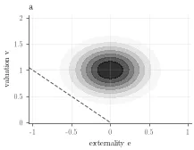<br>`a`: one normal at (e, v) = (0, 1) | 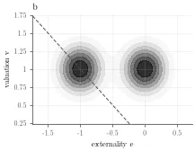<br>`b`: harmful and benign normals, equal v | 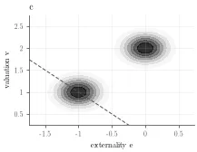<br>`c`: harmful types have low v |
| 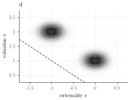<br>`d`: harmful types have high v | 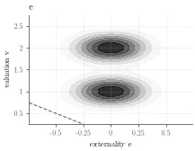<br>`e`: no harm; two v levels | 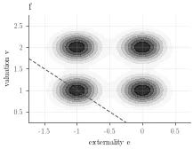<br>`f`: four normals (b–e combined) |
| 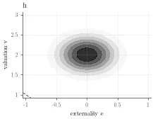<br>`h`: one normal at (e, v) = (0, 2) | 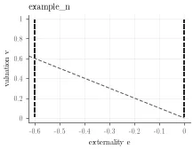<br>`example_n`: Example N: e ∈ {−0.6, 0}, v ~ U[0, 1] | 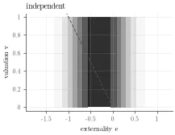<br>`independent`: v ~ U[0, 1] independent of e ~ N(−0.3, 0.5²) |
| 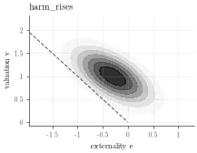<br>`harm_rises`: one normal, correlation −0.6 | 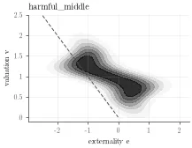<br>`harmful_middle`: steep ridge with a wiggle at v = 1; ironing binds | 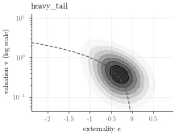<br>`heavy_tail`: lognormal v (log axis), harm grows with v |

<a id="harmful-middle-options"></a>**`harmful_middle` options** ([definitions](#family-options)). Rows 1–3: `wiggle_width` × `wiggle_spread`; row 4: `wiggle_amplitude`; other options at their defaults.

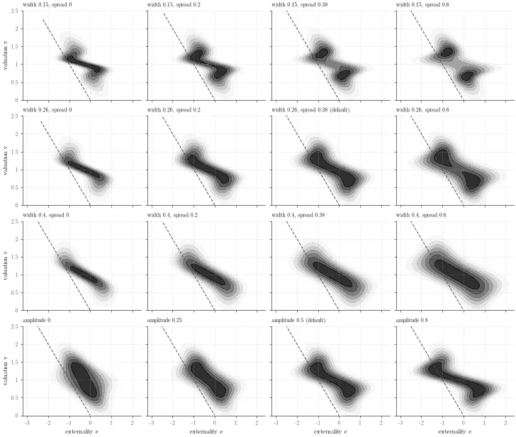

[scripts/draw_distributions.py](../scripts/draw_distributions.py) redraws these previews into [docs/distributions/](distributions/) (about 2 s).

Every family is a piecewise-uniform distribution on a grid: externalities on nodes, valuations uniform within cells. All quantities are exact for that distribution. Definitions and options: [§2.2](#family-options); grid accuracy: [PA_auctions/README.md](../PA_auctions/README.md#synthetic-families).

<a id="continuous-evaluation"></a>**Continuous evaluation** (`[evaluation] continuous = true`, the default). The grid has jumps a continuous density does not have: each externality node is a point mass in e, and the valuation density jumps at cell edges. Under a continuous τ, a whole node enters at its threshold, which makes IVCG-PA iron in many small bands ([§3.4](#34-checks)). The run therefore uses two versions of each gridded distribution:

| Stage | Distribution |
|---|---|
| search (genetic objective, threshold responses, gradient polish), `first_order` check, symmetric relaxation | the grid, where per-node threshold responses and gradients are exact |
| exact outcomes, penalties, simulated auctions, bootstrap of smoothed resamples, IVCG-PA scoring rule, ironing figure, marginal-contribution maps, `sufficient_condition` check | the continuous version: each node's mass spread uniformly over its externality interval (midpoint to midpoint), and the valuation density piecewise linear between cell midpoints |

The continuous version differs from the grid by an error of the same order as the grid's own (second order in the spacing); the exact computation on it is accurate to second order in the piece widths instead of exact, and takes about 5× as long per evaluation. τ is used between the nodes as its form defines it (the `nodes` form interpolates linearly). Atomic data (the test rows by default) and `example_n` (two externality values) keep their externalities. Methods: [PA_auctions/README.md](../PA_auctions/README.md#continuous-versions).

**Empirical data:** any CSV with columns `e_score`, `v_score`; e = ζ · e_score and v = `valuation_scale` · v_score. Processing:

- rows are split ½/½ into training and test halves;
- each half is truncated at a valuation quantile (v̄; default 0.995);
- τ is searched on the kernel-smoothed training half, and the IVCG-PA scores are designed on its continuous version;
- outcomes are evaluated exactly on the atomic test rows (or on the continuous version of the smoothed test half, `evaluation = "smoothed"`);
- the bootstrap resamples the test rows.

## 5. Python interface

| Function | Module | Does |
|---|---|---|
| `synthetic_distribution(name, externality_scale, **options)` | `type_distributions` | a synthetic family |
| `distribution.continuous_version()`, `distribution.refined_version()` | `type_distributions` | continuous version of a gridded distribution; its discrete approximation |
| `prepare_distributions(source, ..., continuous=...)` | `pipeline` | training, design and evaluation distributions of a family or CSV |
| `evaluate_threshold(distribution, τ, n, k, num_simulated_draws=...)` | `threshold_evaluation` | exact outcomes, penalties, simulated auctions |
| `exact_outcomes(distribution, τ, n, k)` | `threshold_evaluation` | exact outcomes only (welfare and its parts, revenue, penalties, bidder utility) |
| `expected_welfare(distribution, τ, n, k, mechanism)` | `threshold_evaluation` | the optimization objective |
| `optimize_threshold(training, form, n, k, objective, optimizer)` | `pipeline` | search for τ (`optimizer`: `genetic`, `threshold_response`, `genetic+threshold_response`, `relaxation`, `grid`) |
| `run_genetic_search`, `run_threshold_response_ascent` | `genetic_search`, `threshold_response_ascent` | the two search algorithms |
| `symmetric_relaxation(distribution, n, k)` | `symmetric_relaxation` | best symmetric participation rule for VCG-PA (bound and τ) |
| `participation_gap(distribution, τ, n, k)` | `threshold_response_ascent` | G(τ) of the sufficient condition |
| `first_order_check(distribution, τ, n, k, mechanism)` | `threshold_response_ascent` | marginal contribution and Pigouvian charge at each threshold |
| `build_threshold_form(label, distribution)`, `threshold_from_spec(spec)` | `threshold_forms` | forms of τ |
| `run(config_file)`, `make_report(run_folder)` | `experiments.runner`, `experiments.report` | a whole run; its figures |
